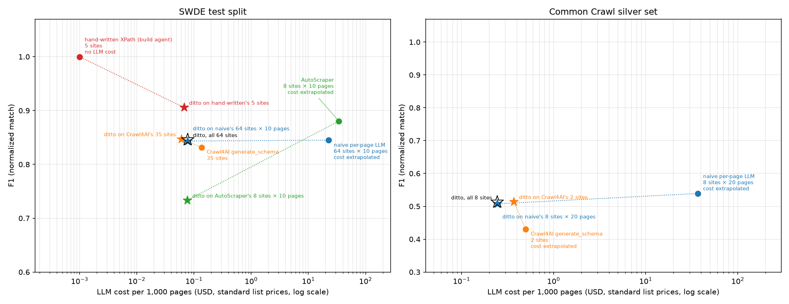

# ditto

Extract a whole downloaded website into JSON with about one LLM call per page template.

ditto groups the pages of a site (an HTML directory or WARC files, up to ~100k pages) by
template, shows an LLM one compressed page per template, and gets back a reusable *spec*: XPath
1.0 selectors plus a closed set of transforms. It verifies every selector against every page,
repairs what fails, and runs the specs over the whole site with no LLM at all. The spec is plain
data you keep, edit and run inside your own scraper.

## 30-second example

```bash
# a 200-page sample site (synthetic, generated by `ditto synth`) ships with the repository
git clone https://github.com/luaygz/ditto && cd ditto
pip install .                              # from PyPI once published: pip install ditto-extract
echo "OPENAI_API_KEY=sk-..." > .env
cat tests/fixtures/site/fields.yaml
```

```yaml
# Prompted-mode schema for the fixture site, used by the integration test and the README example.
title: the main title or headline shown as the page heading
published: the date the page was published or released
tags: the topic tags, keywords or topics listed on the page
```

```bash
ditto run tests/fixtures/site/site --out /tmp/readme-run --schema tests/fixtures/site/fields.yaml --yes
```

`ditto run` ingests the directory, clusters it into templates, makes one spec-generation call
per template, verifies and extracts. One JSONL file per template lands in
`/tmp/readme-run/out/<site>/`, next to the specs (`specs/`) and a report (`report.md`). Two
rows from that run, from two different templates:

```console
$ head -n 1 /tmp/readme-run/out/www.munoz-tyler.com/t_0c6f.jsonl
{"url":"https://www.munoz-tyler.com/blog/2016/05/sackingen-plans-appear-board-news-early-10442","page_id":0,"template_id":"t_0c6f","title":"Säckingen Plans Appear Board News Early","published":"2015-12-13","tags":["above","adult","land","available","budget"],"_meta":{"missing":[],"spec_version":"1"}}
$ head -n 1 /tmp/readme-run/out/www.munoz-tyler.com/t_b071.jsonl
{"url":"https://www.munoz-tyler.com/movies/10003/the-year","page_id":107,"template_id":"t_b071","title":"The Year","published":"Jan 14, 2019","tags":["music"],"_meta":{"missing":[],"spec_version":"1"}}
```

The fixture site is synthetic (fake names and text from Faker), so it shows the mechanics, not
accuracy; the [results](#results) below are on real sites. Without `--yes`, `ditto run` stops
at two checkpoints: the field-to-candidate mapping before generation and five sample records per
template before extraction.

## What it does

| Stage | Output | LLM |
| --- | --- | --- |
| 1. ingest an HTML directory (optional `urls.tsv`) or WARC files | `pages.sqlite` | no |
| 2. parse, strip scripts and styles, compute structural paths | `fingerprints/` | no |
| 3. cluster pages into templates (MinHash LSH over path signatures) | `clusters.json` | no |
| 4. analyze each template: candidate fields, lists, tables, labels | `candidates/` | no |
| 5. build one annotated, compressed *union page* per template (at most 30k tokens) | `union/` | no |
| 6. generate a spec | `specs/draft/` | 1 call per template |
| 7. verify every selector on every page; repair within a call budget | `specs/` | repairs only |
| 8. extract | `out/<site>/<template>.jsonl`, `report.md` | no |

Two modes share one spec format: **prompted** (you list the fields in a `fields.yaml`) and
**unprompted** (the LLM names and filters the fields the analysis found). Selectors are
relative, anchored XPath 1.0 with two or three candidates per field; table columns are addressed
by header text; nothing the model writes is ever executed. `<script>` blocks (JSON-LD included)
and `<head>` except `<title>` never reach the model or the extractor. Details:
[docs/how-it-works.md](docs/how-it-works.md); spec format: [docs/spec-format.md](docs/spec-format.md).

## Install

```bash
pip install ditto-extract                  # once published; until then `pip install .` in a clone
pip install 'ditto-extract[eval,synth]'    # optional: benchmark harness (Crawl4AI, charts), synthetic sites
```

The distribution is `ditto-extract`; the import and the CLI are `ditto`. Python 3.11+. Settings
come from the environment or a `.env` file in the working directory:

```bash
OPENAI_API_KEY=sk-...                      # required for the LLM stages
# OPENAI_BASE_URL=https://openrouter.ai/api/v1   # any OpenAI-compatible endpoint: OpenRouter, vLLM, Ollama, Together
# OPENAI_MODEL=...  OPENAI_MODEL_SMALL=...       # default: picked from the endpoint's /models list
# ANTHROPIC_API_KEY=...  DITTO_MODEL_GENERATION=anthropic/<model>  DITTO_MODEL_REPAIR=anthropic/<model>
# LLM_BUDGET_USD=40                        # ditto refuses a run whose projected cost exceeds what is left
```

The main model writes and repairs specs; the small model only serves `--probe-llm` and
`--tail direct`. Every response is cached under `.cache/llm/`, so reruns cost nothing. Every
variable: [docs/cli.md](docs/cli.md#configuration).

## CLI

| Command | What it does |
| --- | --- |
| `ditto run <src> --out <run> [--mode ...] [--schema ...] [--yes] [--tail skip\|direct\|spec]` | all stages in order, pausing at the two checkpoints unless `--yes` |
| `ditto ingest`, `cluster`, `analyze`, `probe`, `confirm`, `generate`, `verify`, `review`, `extract` | the same stages one at a time on a run directory (`probe` maps fields to candidates without an LLM; `generate` is the LLM step) |
| `ditto eval run eval/configs/<name>.yaml` | regenerates benchmark numbers into `eval/results/` |
| `ditto synth generate --params eval/synth/default.yaml --seed 1 --out <dir>` | builds a synthetic site with ground truth |

Pages in templates smaller than `--min-cluster-size` (default 20) are the long tail: skipped by
default, sent page by page to the small model with `--tail direct`, or given specs anyway with
`--tail spec`. Every option: [docs/cli.md](docs/cli.md).

## Python API

```python
from ditto import Site, Spec

site = Site.from_dir("pages/", run_dir="runs/example")    # or Site.from_warc([...])
site.cluster()
site.analyze()
mapping = site.probe("fields.yaml").confirm()              # confirm(edits={tid: {field: "c17"}})
site.generate("prompted", schema="fields.yaml", mapping=mapping)
site.verify(max_repair_calls=3)
site.review()
site.extract()
rows = list(site.records())

# one finished spec on one page: no LLM, no run directory, nothing else
spec = Spec.load("runs/example/specs/t_b071.json")
row = spec.apply(html)     # {"title": ..., "published": ..., "tags": [...], "_meta": {...}}
```

`Spec.load(path).apply(html)` is the call to embed in your own scraper. On macOS and Windows
(spawned worker processes), keep API calls under `if __name__ == "__main__":`. Reference:
[docs/python-api.md](docs/python-api.md).

## Results

Every number in this section is written by `uv run python eval/report.py` from the latest
`eval/results/<name>/<timestamp>/` of each evaluation config (`ditto eval run
eval/configs/<name>.yaml`); nothing between the result markers is typed by hand. Datasets,
metrics and one command per evaluation: [docs/benchmarks.md](docs/benchmarks.md).

**Unseen pages only.** Each spec is generated from one union page built from a base page plus
the pages that donate missing fields (one to three pages for most templates, more where many
optional fields had to be spliced in) and scored on all the other pages, so each ditto accuracy
number is on pages the LLM never saw. ditto and every baseline get the same page (`<script>`
blocks removed, as in production) and the same pinned main model.

**Three F1 columns.** `raw` is exact string equality. `norm` (normalized) ignores whitespace,
case, currency symbols, thousands separators, trailing punctuation and leading separators.
`canon` adds four formatting rules (accents, a trailing `|`, digit grouping in long identifiers
such as ISBNs, several labeled values joined in one string) that were derived from the misses
on the SWDE development slice only and frozen, as metric version 2, before any test set was
rescored. Results produced before metric version 2 show `–` in the `canon` column.

**Like for like.** Baselines ran on fewer sites or on seeded page samples (budget); below each
baseline row, `↳ ditto, same sites and pages` scores ditto on exactly that baseline's sites and
pages. Per-page baselines' cost per 1,000 pages is extrapolated from their samples.

<!-- results:headline:start -->


LLM cost per 1,000 pages (log scale; every method's tokens at the same standard-tier list prices from `config/prices.yaml`) against normalized F1. Black star: ditto on every site. Each baseline (circle) is joined by a dotted line to ditto (star, same colour) scored on exactly that baseline's sites and pages. A method without LLM cost sits at the left edge.

Sources (latest run per config): [swde_test_ditto](eval/results/swde_test_ditto/20261027T174101Z) · [swde_test_naive](eval/results/swde_test_naive/20261027T165317Z) · [swde_test_crawl4ai](eval/results/swde_test_crawl4ai/20261027T181758Z) · [swde_test_autoscraper](eval/results/swde_test_autoscraper/20261027T171529Z) · [swde_test_handwritten](eval/results/swde_test_handwritten/20261027T172907Z) · [cc_silver_ditto](eval/results/cc_silver_ditto/20261027T144715Z) · [cc_silver_naive](eval/results/cc_silver_naive/20261027T152228Z) · [cc_silver_crawl4ai](eval/results/cc_silver_crawl4ai/20261027T153152Z). Regenerate with `uv run ditto eval run eval/configs/<name>.yaml`, then `uv run python eval/report.py`.
<!-- results:headline:end -->

### SWDE

Hao et al., SIGIR 2011: 8 verticals × 10 sites, human labels. The two alphabetically first sites
per vertical are the development slice (tuning allowed); the other 64 are the frozen test split.

<!-- results:swde:start -->
**SWDE test split (frozen, never tuned on)**

| method | scored on | pages scored | F1 norm | F1 raw | F1 canon | input tokens / 1k pages | output tokens / 1k pages | LLM calls / template | $ / 1k pages | speed | status |
| --- | --- | --- | --- | --- | --- | --- | --- | --- | --- | --- | --- |
| ditto (prompted) | 64 sites, all labeled pages the LLM did not see | 96,659 | 0.846 | 0.771 | 0.866 | 35,574 | 652 | 1.45 | $0.0777 | 83 pages/s/core (extract) | ok |
| naive per-page LLM | 64 sites, seeded 10-page sample per site | 640 | 0.845 | 0.773 | 0.891 | 11,025,011 | 53,805 | 9.39 | $22.59 (extrapolated) | 65.42 pages/s (wall) | ok |
| ↳ ditto, same sites and pages | the same 64 sites, same samples minus pages the LLM saw | 634 | 0.843 | 0.769 | 0.863 | 35,574 | 652 | 1.45 | $0.0777 | 83 pages/s/core (extract) | ok |
| Crawl4AI generate_schema | 35 of 64 sites, all labeled pages | 53,967 | 0.831 | 0.720 | 0.842 | 58,248 | 1,952 | 1.55 | $0.1360 | 144.83 pages/s (wall) | ok on 35 of 36 sites (1 failed) |
| ↳ ditto, same sites and pages | the same 35 sites, labeled pages the LLM did not see | 53,617 | 0.847 | 0.735 | 0.865 | 26,789 | 625 | 1.46 | $0.0598 | 91 pages/s/core (extract) | ok |
| AutoScraper | 8 of 64 sites, seeded 10-page sample per site | 80 | 0.880 | 0.781 | 0.880 | 15,053,888 | 405,562 | 51.00 | $34.16 (extrapolated) | 0.10 pages/s (wall) | ok |
| ↳ ditto, same sites and pages | the same 8 sites, same samples minus pages the LLM saw | 79 | 0.733 | 0.671 | 0.774 | 34,828 | 661 | 2.12 | $0.0763 | 84 pages/s/core (extract) | ok |
| hand-written XPath (build agent) | 5 of 64 sites, all labeled pages | 7,465 | 1.000 | 1.000 | 1.000 | 0 | 0 | 0.00 | $0 | 1,101.29 pages/s (wall) | ok on 5 of 64 sites (59 not_run) |
| ↳ ditto, same sites and pages | the same 5 sites, labeled pages the LLM did not see | 7,362 | 0.906 | 0.906 | 0.906 | 29,613 | 754 | 1.00 | $0.0668 | 69 pages/s/core (extract) | ok |

- ditto (prompted): the LLM saw 738 of 97,397 labeled pages (0.76%) while generating 78 specs; they are left out of every ditto score.

Sources (latest run per config): [swde_test_ditto](eval/results/swde_test_ditto/20261027T174101Z) · [swde_test_naive](eval/results/swde_test_naive/20261027T165317Z) · [swde_test_crawl4ai](eval/results/swde_test_crawl4ai/20261027T181758Z) · [swde_test_autoscraper](eval/results/swde_test_autoscraper/20261027T171529Z) · [swde_test_handwritten](eval/results/swde_test_handwritten/20261027T172907Z). Regenerate with `uv run ditto eval run eval/configs/<name>.yaml`, then `uv run python eval/report.py`.

**SWDE development slice (tuning allowed)**

| method | scored on | pages scored | F1 norm | F1 raw | F1 canon | input tokens / 1k pages | output tokens / 1k pages | LLM calls / template | $ / 1k pages | speed | status |
| --- | --- | --- | --- | --- | --- | --- | --- | --- | --- | --- | --- |
| ditto (prompted) | 16 sites, all labeled pages the LLM did not see | 26,777 | 0.877 | 0.861 | 0.892 | 32,773 | 756 | 1.72 | $0.0731 | 105 pages/s/core (extract) | ok |
| ditto (unprompted) | 16 sites, all labeled pages the LLM did not see | 26,484 | 0.849 | 0.833 | 0.849 | 43,173 | 3,365 | 2.92 | $0.1200 | 61 pages/s/core (extract) | ok |
| naive per-page LLM | 16 sites, seeded 50-page sample per site | 800 | 0.858 | 0.842 | 0.880 | 11,340,619 | 44,742 | 41.88 | $23.13 (extrapolated) | 79.28 pages/s (wall) | ok |
| ↳ ditto, same sites and pages | the same 16 sites, same samples minus pages the LLM saw | 796 | 0.876 | 0.860 | 0.890 | 32,773 | 756 | 1.72 | $0.0731 | 105 pages/s/core (extract) | ok |

- ditto (prompted): the LLM saw 117 of 26,894 labeled pages (0.44%) while generating 23 specs; they are left out of every ditto score.
- ditto (unprompted): the LLM saw 410 of 26,894 labeled pages (1.52%) while generating 23 specs; they are left out of every ditto score.
- ditto (unprompted), recall of the labeled attributes after aligning the LLM's field names to label names by value overlap: normalized 0.847, raw 0.831, canon 0.847
- ditto (unprompted), schema precision: 0.908 (187 of 206 proposed fields on 10 sites judged entity attributes; judged field by field by the build agent, not a human ([eval/judgments/swde_dev_schema_precision.json](eval/judgments/swde_dev_schema_precision.json)))

Sources (latest run per config): [swde_dev_ditto](eval/results/swde_dev_ditto/20261027T155851Z) · [swde_dev_unprompted](eval/results/swde_dev_unprompted/20261027T161122Z) · [swde_dev_naive](eval/results/swde_dev_naive/20261027T160842Z). Regenerate with `uv run ditto eval run eval/configs/<name>.yaml`, then `uv run python eval/report.py`.
<!-- results:swde:end -->

### Common Crawl silver set

Eight domains in four verticals from the two most recent Common Crawl crawls; labels come from
each site's own schema.org JSON-LD, which is stripped from what the extractor sees. The
label-noise check against the visible text was performed by the build agent, not by a human.

<!-- results:cc_silver:start -->
**Common Crawl silver set**

| method | scored on | pages scored | F1 norm | F1 raw | F1 canon | input tokens / 1k pages | output tokens / 1k pages | LLM calls / template | $ / 1k pages | speed | status |
| --- | --- | --- | --- | --- | --- | --- | --- | --- | --- | --- | --- |
| ditto (prompted) | 8 sites, all labeled pages the LLM did not see | 20,368 | 0.513 | 0.468 | 0.513 | 105,904 | 3,249 | 2.05 | $0.2443 | 50 pages/s/core (extract) | ok |
| naive per-page LLM | 8 sites, seeded 20-page sample per site | 160 | 0.539 | 0.468 | 0.539 | 17,710,162 | 153,088 | 10.08 | $36.95 (extrapolated) | 0.42 pages/s (wall) | ok |
| ↳ ditto, same sites and pages | the same 8 sites, same samples minus pages the LLM saw | 154 | 0.508 | 0.459 | 0.508 | 105,904 | 3,249 | 2.05 | $0.2443 | 50 pages/s/core (extract) | ok |
| Crawl4AI generate_schema | 2 of 8 sites, all labeled pages | 4,177 | 0.431 | 0.396 | 0.431 | 217,224 | 6,177 | 3.31 | $0.4962 (extrapolated) | 6.23 pages/s (wall) | ok on 2 of 8 sites (6 skipped) |
| ↳ ditto, same sites and pages | the same 2 sites, labeled pages the LLM did not see | 3,955 | 0.514 | 0.425 | 0.514 | 153,390 | 6,332 | 2.29 | $0.3701 | 63 pages/s/core (extract) | ok |

- ditto (prompted): the LLM saw 757 of 21,125 labeled pages (3.58%) while generating 56 specs; they are left out of every ditto score.
- ditto (prompted), optional-field recall (attribute on the page but on none of the pages the LLM saw for its template; 273 pages): normalized 0.004, raw 0.000

Sources (latest run per config): [cc_silver_ditto](eval/results/cc_silver_ditto/20261027T144715Z) · [cc_silver_naive](eval/results/cc_silver_naive/20261027T152228Z) · [cc_silver_crawl4ai](eval/results/cc_silver_crawl4ai/20261027T153152Z). Regenerate with `uv run ditto eval run eval/configs/<name>.yaml`, then `uv run python eval/report.py`.

Domains (selected 2026-10-24; from [eval/datasets/commoncrawl_silver/domains.yaml](eval/datasets/commoncrawl_silver/domains.yaml)); download cap 2,500 pages per domain, detail pages first, then a sample of other pages:

| domain | vertical | JSON-LD type | HTML captures in the index, per crawl | distinct URLs | pages downloaded of planned |
| --- | --- | --- | --- | --- | --- |
| `argos.co.uk` | product | Product | CC-MAIN-2026-43: 17,747; CC-MAIN-2026-39: 15,620 | 33,133 | 7,201 of 7,201 |
| `ikea.com` | product | Product | CC-MAIN-2026-43: 28,713; CC-MAIN-2026-39: 27,251 | 52,880 | 2,500 of 2,500 |
| `careerbuilder.com` | job | JobPosting | CC-MAIN-2026-43: 15,682; CC-MAIN-2026-39: 16,562 | 32,051 | 2,500 of 2,500 |
| `dice.com` | job | JobPosting | CC-MAIN-2026-43: 11,685; CC-MAIN-2026-39: 11,896 | 22,873 | 2,500 of 2,500 |
| `marmiton.org` | recipe | Recipe | CC-MAIN-2026-43: 13,305; CC-MAIN-2026-39: 12,923 | 25,846 | 2,500 of 2,500 |
| `food.ndtv.com` | recipe | Recipe | CC-MAIN-2026-43: 24,262; CC-MAIN-2026-39: 23,695 | 46,377 | 2,500 of 2,500 |
| `ticketweb.com` | event | Event | CC-MAIN-2026-43: 14,195; CC-MAIN-2026-39: 14,585 | 28,272 | 2,500 of 2,500 |
| `skiddle.com` | event | Event | CC-MAIN-2026-43: 12,698; CC-MAIN-2026-39: 13,935 | 24,475 | 2,500 of 2,500 |

Label-noise check: each JSON-LD label compared with the text the extractor sees, on 200 pages from a sample of the downloaded pages, 8 domains; performed by build agent (automated script noise_check.py), not a human ([eval/datasets/commoncrawl_silver/noise_check.json](eval/datasets/commoncrawl_silver/noise_check.json), `uv run python eval/datasets/commoncrawl_silver/noise_check.py`). 13 fields agree on fewer than 80% of the checked pages; they are listed under [Limitations](#limitations).
<!-- results:cc_silver:end -->

### LiveWeb-IE

The permission-granted sites of LiveWeb-IE (ICLR 2026, arXiv 2603.13773), scored per query
complexity type on a frozen snapshot, not on the live sites.

<!-- results:livewebie:start -->
Snapshot status: partial. 9 of 15 LiveWeb-IE websites usable (arxiv.org, books.toscrape.com, huggingface.co, marinespecies.org, quotes.toscrape.com, sandbox.oxylabs.io, scrapethissite.com, thecocktaildb.com, themealdb.com); excluded: dp.la, fueleconomy.gov, iclr.cc, icml.cc, neurips.cc, thesportsdb.com (see each site's excluded_reason and diagnosis) ([eval/datasets/livewebie/manifest.json](eval/datasets/livewebie/manifest.json))

Excluded: `dp.la` (no page fetched with HTTP 200); `fueleconomy.gov` (robots.txt unreachable); `iclr.cc` (only 0.0473 of ground-truth values appear in the extractor input of the fetched pages); `icml.cc` (only 0.062 of ground-truth values appear in the extractor input of the fetched pages); `neurips.cc` (only 0.0584 of ground-truth values appear in the extractor input of the fetched pages); `thesportsdb.com` (robots.txt Content-Signal ai-input=no).

**ditto (prompted)** on the snapshot, mean field F1 per query complexity type:

| complexity type | F1 norm | F1 raw | F1 canon | sites |
| --- | --- | --- | --- | --- |
| type_1 (one single-valued attribute) | 0.745 | 0.721 | 0.745 | 8 |
| type_2 (several single-valued attributes) | 0.752 | 0.710 | 0.752 | 7 |
| type_3 (one list-valued attribute) | 0.775 | 0.747 | 0.775 | 9 |
| type_4 (several list-valued attributes) | 0.733 | 0.695 | 0.733 | 9 |
| all fields | 0.724 | 0.706 | 0.724 | 9 |

Input tokens per 1k pages 145,738, LLM calls per template 2.28, $ per 1k pages $0.3762.

Sources (latest run per config): [livewebie_ditto](eval/results/livewebie_ditto/20261027T181651Z). Regenerate with `uv run ditto eval run eval/configs/<name>.yaml`, then `uv run python eval/report.py`.
<!-- results:livewebie:end -->

### Clustering

Synthetic sites with known templates (frozen seed 1); the stress curves vary one generator
parameter at a time from the defaults.

<!-- results:clustering:start -->
**Synthetic default site** (frozen seed 1)

| evaluation | pages | true templates | clusters found | ARI | purity | over-merged clusters | under-merged templates | fingerprint pages/s/core | cluster pages/s/core | status |
| --- | --- | --- | --- | --- | --- | --- | --- | --- | --- | --- |
| synth_default | 10,000 | 15 | 15 | 1.000 | 1.000 | 0 | 0 | 279 | 9,667 | ok |
| synth_nightly | 10,000 | 15 | 15 | 1.000 | 1.000 | 0 | 0 | 321 | 12,395 | ok |
| synth_scale | 100,000 | 15 | 15 | 1.000 | 1.000 | 0 | 0 | 305 | 40,698 | ok |

**Stress curves** (`synth_curves`: one parameter at a time from the defaults)

| stress parameter | value: ARI | min ARI | min purity | chart |
| --- | --- | --- | --- | --- |
| absent_rendering | empty: 1.000 · hidden: 1.000 · na: 1.000 · omitted (default): 1.000 | 1.000 | 1.000 | [chart](docs/img/synth_absent_rendering.png) |
| boilerplate_share | 0.1: 1.000 · 0.4 (default): 1.000 · 0.6: 1.000 · 0.8: 1.000 | 1.000 | 1.000 | [chart](docs/img/synth_boilerplate_share.png) |
| boilerplate_variants | 2: 1.000 · 3 (default): 1.000 · 5: 1.000 | 1.000 | 1.000 | [chart](docs/img/synth_boilerplate_variants.png) |
| hashed_class_share | 0.0: 1.000 · 0.3 (default): 1.000 · 0.6: 1.000 · 1.0: 1.000 | 1.000 | 1.000 | [chart](docs/img/synth_hashed_class_share.png) |
| kv_style | div: 1.000 · dl: 1.000 · mixed (default): 1.000 · table: 1.000 | 1.000 | 1.000 | [chart](docs/img/synth_kv_style.png) |
| markup_style | react: 1.000 · server (default): 1.000 · table: 1.000 | 1.000 | 1.000 | [chart](docs/img/synth_markup_style.png) |
| near_duplicate_jaccard | 0.6: 1.000 · 0.7 (default): 1.000 · 0.8: 0.994 · 0.9: 0.994 | 0.994 | 0.978 | [chart](docs/img/synth_near_duplicate_jaccard.png) |
| near_duplicate_pairs | 0: 1.000 · 1 (default): 1.000 · 3: 1.000 · 5: 1.000 | 1.000 | 1.000 | [chart](docs/img/synth_near_duplicate_pairs.png) |
| noise | none (default): 1.000 · [entities]: 1.000 · [entities, nbsp, whitespace]: 1.000 · [nbsp]: 1.000 · [whitespace]: 1.000 | 1.000 | 1.000 | [chart](docs/img/synth_noise.png) |
| optional_columns | 0: 1.000 · 1 (default): 1.000 · 2: 1.000 | 1.000 | 1.000 | [chart](docs/img/synth_optional_columns.png) |
| optional_fields | 0: 1.000 · 3 (default): 1.000 · 6: 1.000 · 10: 1.000 | 1.000 | 1.000 | [chart](docs/img/synth_optional_fields.png) |
| optional_presence | [0.02, 0.1]: 1.000 · [0.02, 0.95] (default): 1.000 · [0.5, 0.95]: 1.000 | 1.000 | 1.000 | [chart](docs/img/synth_optional_presence.png) |
| pages_median | 20: 1.000 · 100: 1.000 · 500: 1.000 · 2000 (default): 1.000 | 1.000 | 1.000 | [chart](docs/img/synth_pages_median.png) |
| record_tables | 0: 1.000 · 1 (default): 1.000 · 2: 1.000 · 3: 1.000 | 1.000 | 1.000 | [chart](docs/img/synth_record_tables.png) |
| table_rows | [0, 0]: 1.000 · [0, 12] (default): 1.000 · [0, 100]: 1.000 · [0, 300]: 1.000 | 1.000 | 1.000 | [chart](docs/img/synth_table_rows.png) |
| templates | 2: 1.000 · 12 (default): 1.000 · 50: 1.000 · 100: 1.000 · 200: 0.999 | 0.999 | 0.997 | [chart](docs/img/synth_templates.png) |

Sources (latest run per config): [synth_default](eval/results/synth_default/20261027T154354Z) · [synth_nightly](eval/results/synth_nightly/20261027T154448Z) · [synth_scale](eval/results/synth_scale/20261027T154401Z) · [synth_curves](eval/results/synth_curves/20261027T154454Z). Regenerate with `uv run ditto eval run eval/configs/<name>.yaml`, then `uv run python eval/report.py`.
<!-- results:clustering:end -->

### LLM spend

Spend figures are ditto's own ledger. A billing check during the build found the provider
charging about 23% more than the ledger recorded over the same period (cause not found; see
`DECISIONS.md`). The whole build's spend, development and tuning included, is broken down by
phase in [BUILD_REPORT.md](BUILD_REPORT.md).

<!-- results:spend:start -->
| evaluation | method | status | LLM cost of the published run | billed in kept runs (ledger) | budget cap | latest run |
| --- | --- | --- | --- | --- | --- | --- |
| `cc_silver_crawl4ai` | Crawl4AI generate_schema | ok on 2 of 8 sites (6 skipped) | $2.07 | $2.07 | $1.50 | [20261027T153152Z](eval/results/cc_silver_crawl4ai/20261027T153152Z) |
| `cc_silver_ditto` | ditto (prompted) | ok | $6.03 | $5.46 | $6.00 | [20261027T144715Z](eval/results/cc_silver_ditto/20261027T144715Z) |
| `cc_silver_naive` | naive per-page LLM | ok | $5.91 | $5.88 | $6.00 | [20261027T152228Z](eval/results/cc_silver_naive/20261027T152228Z) |
| `livewebie_ditto` | ditto (prompted) | ok | $1.33 | $0.9047 (2 runs) | $4.00 | [20261027T181651Z](eval/results/livewebie_ditto/20261027T181651Z) |
| `swde_dev_ditto` | ditto (prompted) | ok | $1.97 | $0 (2 runs) | $3.00 | [20261027T155851Z](eval/results/swde_dev_ditto/20261027T155851Z) |
| `swde_dev_naive` | naive per-page LLM | ok | $18.50 | $11.74 (4 runs) | $10.00 | [20261027T160842Z](eval/results/swde_dev_naive/20261027T160842Z) |
| `swde_dev_unprompted` | ditto (unprompted) | ok | $3.23 | $0 (2 runs) | $3.00 | [20261027T161122Z](eval/results/swde_dev_unprompted/20261027T161122Z) |
| `swde_test_autoscraper` | AutoScraper | ok | $2.73 | $2.26 (2 runs) | $5.00 | [20261027T171529Z](eval/results/swde_test_autoscraper/20261027T171529Z) |
| `swde_test_crawl4ai` | Crawl4AI generate_schema | ok on 35 of 36 sites (1 failed) | $7.34 | $5.70 (2 runs) | $1.00 | [20261027T181758Z](eval/results/swde_test_crawl4ai/20261027T181758Z) |
| `swde_test_ditto` | ditto (prompted) | ok | $7.56 | $6.87 (2 runs) | $10.00 | [20261027T174101Z](eval/results/swde_test_ditto/20261027T174101Z) |
| `swde_test_handwritten` | hand-written XPath (build agent) | ok on 5 of 64 sites (59 not_run) | $0 | $0 (2 runs) | $0.0100 | [20261027T172907Z](eval/results/swde_test_handwritten/20261027T172907Z) |
| `swde_test_naive` | naive per-page LLM | ok | $14.46 | $14.46 (2 runs) | $16.00 | [20261027T165317Z](eval/results/swde_test_naive/20261027T165317Z) |

Run without any LLM call: [synth_curves](eval/results/synth_curves/20261027T154454Z), [synth_default](eval/results/synth_default/20261027T154354Z), [synth_nightly](eval/results/synth_nightly/20261027T154448Z), [synth_scale](eval/results/synth_scale/20261027T154401Z), [union_gate_swde_dev](eval/results/union_gate_swde_dev/20261027T155131Z), [union_gate_synth](eval/results/union_gate_synth/20261027T155113Z).

Total LLM cost of the published results: $71.14, every token behind them (cached calls included) at the standard list prices of `config/prices.yaml`, i.e. what rerunning them from an empty cache costs. Billed in the 34 runs kept under `eval/results/`: $55.34 (`meta.json` `spend_usd`, ditto's ledger; a rerun answered from the cache bills $0, and runs kept for the audit trail count too). Rewrite with `uv run python eval/report.py`.
<!-- results:spend:end -->

## Models and prompt versions

Prompts are versioned files in [`prompts/`](prompts/): `specgen.v2`, `repair.v1`, `probe.v1`,
`tail_direct.v1` and `naive_baseline.v1` (the loader picks the highest version; `specgen.v1` is
kept for the record). Every spec records the model and prompt version that produced it.

<!-- results:models:start -->
Models used by the published results: `openai/gpt-6.1-sol` (11 evaluations). Prompt versions: `autoscraper@3d78f8a`, `crawl4ai.generate_schema`, `naive_baseline.v1`, `repair.v1`, `specgen.v2`.

Pinned in `eval/configs/*.yaml` (a run fails if the LLM layer resolves another id): baseline: `openai/gpt-6.1-sol`; generation: `openai/gpt-6.1-sol`; probe: `openai/gpt-5.4-mini`; repair: `openai/gpt-6.1-sol`; tail_direct: `openai/gpt-5.4-mini`.

Each run records them in `meta.json`; rewrite with `uv run python eval/report.py`.
<!-- results:models:end -->

## Limitations

Every shortfall, skipped evaluation and extrapolation; the first list is generated from the
results and dataset files.

<!-- results:limitations:start -->
- **The per-page baseline ran on page samples**: seeded samples of 50 on the SWDE dev slice, 10 on the SWDE test split, 20 on the Common Crawl silver set (pages per site) instead of the planned 200, to fit the LLM budget. Its cost per 1,000 pages is extrapolated from the sample, and ditto is compared with it on the same sampled pages.
- **Crawl4AI generate_schema** on the SWDE test split covers 35 of 64 sites (budget: Crawl4AI cost more per site than estimated); the tables compare it with ditto on the same sites and pages.
- **AutoScraper** on the SWDE test split covers 8 of 64 sites, on a seeded 10-page sample per site (budget: one site per vertical, as it makes many model calls per template); the tables compare it with ditto on the same sites and pages.
- **hand-written XPath (build agent)** on the SWDE test split covers 5 of 64 sites (the build agent wrote wrappers for these sites only); the tables compare it with ditto on the same sites and pages.
- **Crawl4AI generate_schema** on the Common Crawl silver set covers 2 of 8 sites (budget: Crawl4AI cost more per site than estimated); the tables compare it with ditto on the same sites and pages.
- **Common Crawl capped at 2,500 pages per domain** (`argos.co.uk` 7,201: pages fetched before the cap was lowered are kept) instead of the planned 20,000: Common Crawl's CloudFront firewall blocked this machine's IP when it fetched at 4 concurrent requests, and at the polite rate of one request per second 20,000 pages per domain did not fit the time available.
- **Common Crawl labels are silver**: they come from each site's own JSON-LD, not from people. The label-noise check (by the build agent, not a human) found labels that agree with the visible text on fewer than 80% of the checked pages: `careerbuilder.com` datePosted 0.00 (25 pages); `careerbuilder.com` employmentType 0.60 (25 pages); `dice.com` datePosted 0.00 (25 pages); `dice.com` employmentType 0.72 (25 pages); `ikea.com` name 0.04 (25 pages); `ikea.com` priceCurrency 0.76 (25 pages); `ikea.com` availability 0.00 (23 pages); `marmiton.org` recipeYield 0.00 (25 pages); `marmiton.org` ingredients 0.48 (25 pages); `skiddle.com` endDate 0.76 (25 pages); `skiddle.com` organizer 0.42 (24 pages); `ticketweb.com` startDate 0.20 (25 pages); `ticketweb.com` endDate 0.00 (4 pages); a miss on such a field is often a label problem, not an extraction error.
- **LiveWeb-IE on 9 of 15 sites** (exclusion reasons in the LiveWeb-IE section), scored on a frozen snapshot with field definitions instead of the live sites and free-form queries, so its numbers are not comparable with the paper's. The release is licensed for non-commercial research only; the snapshot stays out of the repository.
- **Synthetic templates are separable by construction** (the generator re-rolls templates until every pair differs clearly, except the designated near-duplicate pairs), so the clustering curves are near-perfect: minimum ARI 0.994 over 62 points; templates merge only at near_duplicate_jaccard = 0.8, near_duplicate_jaccard = 0.9, templates = 100. They show scale and robustness to markup noise, not accuracy on real sites.
- **SWDE label problems dominate ditto's remaining dev misses**: of its 11,656 misses under `norm` on the dev slice, an estimated 72% are label problems (truncated, over-long or missing labels), 11% real errors and 17% formatting differences, from a stratified sample of 84 misses classified by the build agent, not a human (`eval/analysis/swde_dev_misses.md`).
- **Extraction speed in the evaluation runs** falls short of the target of 500 pages per second per core: 50 on `cc_silver_ditto`, 153 on `livewebie_ditto`, 105 on `swde_dev_ditto`, 61 on `swde_dev_unprompted`, 83 on `swde_test_ditto` pages/s/core (parse included, mean over sites; per-core figures divide by the number of worker processes, on a machine with 16 logical CPUs).
<!-- results:limitations:end -->

- **Cost of template-level baselines.** AutoScraper's cost per 1,000 pages scales its 10-page
  sample's cost linearly, but it writes its rules once per template and reuses them, so on whole
  sites it would cost far less per page. Crawl4AI's token counts come from a hook that recorded
  less than the ledger billed for the same calls, so its cost is likely understated; rerunning
  its configs is not free either (its validation loop is only partly served from the response
  cache: the last SWDE rerun billed $1.98, and one listed site stopped at the budget guard).
  OpenAI's Flex tier was mostly unavailable, so baselines were billed at standard prices.
- **Judged by the build agent.** The schema-precision judgment, the Common Crawl label-noise
  check, the SWDE dev miss classification and the hand-written wrappers are the work of the
  build agent (the LLM that built ditto), not of a human.
- **Pinned models.** Every evaluation uses `gpt-6.1-sol` and `gpt-5.4-mini`, the ids selected
  when the build started; a fresh install now auto-selects `gpt-6.1-terra`, released during the
  build and not evaluated (set `OPENAI_MODEL=gpt-6.1-sol` to reproduce).
- **Speed bench.** The evaluation runs time many small sites with a full worker pool each; the
  extraction bench on 2,000-page SWDE sites (`uv run python eval/bench/speed.py`) is reported in
  [BUILD_REPORT.md](BUILD_REPORT.md), not regenerated by the harness.
- **Pipeline.** Union pages under the 8k-token minimum are not padded (only the 30k cap holds).
  Verification merges two templates when one spec reaches its presence rates on the other's
  pages, so near-duplicate page types share one spec and one JSONL file.
- **Release.** The Anthropic adapter is unit-tested but was never called live (no key). Not on
  PyPI yet: publishing needs the owner's token (`make publish`, see
  [CONTRIBUTING.md](CONTRIBUTING.md)).
- **No incremental re-crawls.** A changed site is re-extracted by rerunning the pipeline;
  detecting template drift from the per-field statistics each spec stores is left for after 1.0.

## License

MIT, see [LICENSE](LICENSE). Contributing: [CONTRIBUTING.md](CONTRIBUTING.md); changes:
[CHANGELOG.md](CHANGELOG.md).
