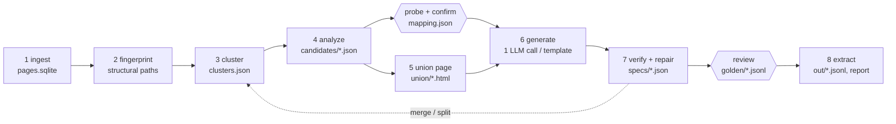

# How ditto works

ditto turns a downloaded website (an HTML directory or WARC files, up to ~100k pages) into JSON.
Instead of sending every page to an LLM, it groups pages by template, shows the LLM one
compressed *union page* per template, and asks it once for a reusable spec: XPath 1.0 selectors
plus a closed set of transforms. The spec is then verified against every page and run over the
whole site with no LLM at all.

Only stage 6, the repair step of stage 7, and the opt-in `--probe-llm` call use an LLM. Every
stage reads and writes files in one run directory, so any stage can be rerun alone.

## 1. Ingest

`ditto ingest` reads a directory of HTML files (with an optional `urls.tsv` of `path<TAB>url`)
or WARC/WARC.gz files. It keeps the latest capture per URL, skips non-HTML and non-200 records,
drops byte-identical duplicates by SHA-256, and detects the encoding from HTTP headers, the BOM,
`<meta charset>`, and finally a statistical detector. Pages are indexed in `pages.sqlite`; raw
bytes stay in the original WARC (by offset) or in content-addressed blobs.

## 2. Fingerprint

Each page is parsed once with lxml and cleaned: `<script>` (including JSON-LD), `<style>`,
`<noscript>`, `<svg>`, `<iframe>`, `<template>`, comments, and `<head>` except `<title>` are
removed. This cleaned tree is exactly what the LLM and the extractor see.

Every element gets a *structural path*: its tags from the root with canonical classes, no
positional indices, e.g. `html > body.page > div.product > dl.specs > dd`. Canonical classes
drop utility prefixes (`mt-`, `px-`, `flex`, `text-`, …), state classes (`active`, `odd`, …) and
hashed names (`css-1x2y3z`, `sc-…`, `_a1b2c`), and keep at most three, sorted. Stable `id`,
`itemprop`, `data-testid` and `role` values are kept. A page's signature is the set of its
paths (repeated siblings collapse to one entry), hashed to 64-bit integers.

## 3. Cluster into templates

Pages with identical signatures form signature groups. Paths present on more than 90% of pages
(site chrome) are dropped; each group gets a 128-permutation MinHash; LSH at threshold 0.75
proposes pairs; exact Jaccard confirms them; union-find yields clusters. URL patterns (digit runs
and slugs replaced by placeholders) only break ties in the 0.6–0.75 band. Clusters smaller than
`--min-cluster-size` (default 20) are the long tail.

## 4. Analyze each cluster

On up to 2,000 sampled pages per cluster (stratified by signature group), every path gets a
presence rate `p`, a modal share `m` (fraction of pages whose text equals the most common text),
and a repeat-count range. Rules: `p ≥ 0.95, m ≥ 0.98` is boilerplate or a label;
`p ≥ 0.95, m < 0.98` is a mandatory field; `0.02 ≤ p < 0.95, m < 0.98` is optional; a varying
repeat count is a list or record; `p < 0.02` is noise. Modal share (not distinct-value ratio)
keeps low-cardinality fields such as availability. Each candidate gets a label hint (the
nearest invariant text), three example values and a guessed value type. Two-column structures
with invariant keys become `key_value` tables; invariant header rows over varying rows become
`record_list` tables with column names from `<th>` text.

## 5. Union page

One page per template is built for the LLM: the sampled page covering the most candidates, with
every optional field missing from it spliced in from a donor page at the aligned position.
Candidates are annotated with HTML comments only (`<!-- c17 · optional · on 41% of pages ·
e.g. … -->`), so nothing the LLM sees is selectable that real pages lack. Boilerplate subtrees
without candidates are removed, repeated siblings are collapsed by variant (never key-value
lists, where each repetition is a different field), attributes are pruned, and long text is
truncated, to fit 8k–30k tokens.

## 6. Generate a spec (one LLM call)

The LLM receives the union page, the compact candidate table, the spec JSON Schema and the mode
instructions. In *prompted* mode it maps the user's `fields.yaml` to candidates (a field it
cannot find comes back as `not_present` with a reason). In *unprompted* mode it filters the
candidates to entity data, names fields in `snake_case` and types them. It writes two or three
candidate selectors per field. The answer is validated against the Pydantic spec model and
every XPath is compiled and linted; one retry carries the exact errors back.

## 7. Verify and repair

Every candidate selector runs on every page of the cluster. Each is scored on presence against
the analysis' expected rate, multiplicity (a scalar must match exactly one node), type checks
(email, URL, number, date, price) and agreement with the other candidates. The winner maximizes
`presence × multiplicity × type_pass`. Pages where the analysis says a field exists but the
selector fails are grouped by signature group, and each group gets one repair call (at most 3
per template by default); fields still failing are marked `degraded`. When every LLM selector
fails, a path-induced selector is built from the candidate's own structural path, with no LLM.
Clusters are then merged when one spec reaches its own presence rates on another cluster, and
split when a field's failures concentrate in one signature group.

## 8. Extract

Final specs run over every page with no LLM, writing one JSONL file per template:
`{url, page_id, template_id, <fields>, _meta: {missing, spec_version}}`, plus `report.json` and
`report.md` with cluster sizes, per-field statistics, token and cost totals and stage timings.

## Checkpoints

`ditto probe` maps requested fields to candidates without an LLM (label-hint similarity,
synonyms, value types, user examples) and marks each field found, ambiguous or missing;
`ditto confirm` accepts or edits that mapping. After verification, `ditto review` shows five
records per template beside their source values for sign-off and saves golden samples. `ditto
run` pauses at both checkpoints in a terminal unless `--yes` is given.

## Long tail

Pages in clusters below `--min-cluster-size` are skipped by default. `--tail direct` sends each
of them to the small model with the prompted schema; `--tail spec` generates specs for them
anyway.
