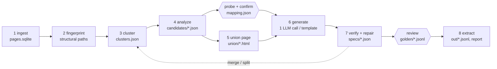

# How ditto works

ditto turns a downloaded website (an HTML directory or WARC files, up to ~100k pages) into JSON.
Instead of sending every page to an LLM, it groups pages by template, shows the LLM one
compressed *union page* per template, and asks it once for a reusable spec: XPath 1.0 selectors
plus a closed set of transforms. The spec is then verified against every page and run over the
whole site with no LLM at all.

The LLM is used only by spec generation (stage 6, one call per template plus at most one retry
when the answer does not validate), repair calls in verification and review, the opt-in
`--probe-llm` call and the opt-in `--tail direct` mode. Every other stage runs without a model.
Every stage reads and writes files in one run directory, so any stage can be rerun alone.

## 1. Ingest

`ditto ingest` reads a directory of HTML files (with an optional `urls.tsv` of `path<TAB>url`)
or WARC/WARC.gz files. It keeps the latest capture per URL, skips non-HTML, non-200, revisit and
empty records, and drops byte-identical duplicates by SHA-256 (the copy with the smallest URL
survives). The encoding comes from the BOM, then the HTTP charset, then `<meta charset>` or the
XML declaration, then a strict UTF-8 check, then a statistical detector, with cp1252 as the last
resort. Pages are indexed in `pages.sqlite` with dense ids in URL order; raw bytes stay in the
original WARC (by offset) or in content-addressed blobs.

## 2. Fingerprint

Each page is parsed with lxml and cleaned: `<script>` (including JSON-LD), `<style>`,
`<noscript>`, `<svg>`, `<iframe>`, `<template>`, comments, processing instructions, and `<head>`
except `<title>` are removed. Every later stage cleans pages the same way, so this cleaned tree
is exactly what the LLM and the extractor see.

Every element gets a *structural path*: its tags from the root with canonical classes, no
positional indices, e.g. `html > body.page > div.product > dl.specs > dd`. Canonical classes
drop utility prefixes (`mt-`, `px-`, `flex`, `text-`, …), state classes (`active`, `odd`, …) and
hashed names (`css-1x2y3z`, `sc-…`, `_a1b2c`), and keep at most three, sorted. An `id` is kept
only when it has no digit and does not look hashed; `itemprop`, `data-testid` and `role` values
are kept. A page's signature is the set of its paths (repeated siblings collapse to one entry),
hashed to 64-bit integers.

## 3. Cluster into templates

Pages with identical signatures form signature groups. Paths present on more than 90% of pages
(site chrome) are dropped from the comparison. Each group gets a 128-permutation MinHash, and an
LSH index at Jaccard 0.6 proposes candidate pairs. Exact Jaccard decides: pairs at 0.75 or above
are joined; pairs between 0.6 and 0.75 are joined only when both sides share the same dominant
URL pattern (digit runs, hex ids, slugs and query values replaced by placeholders) and that
pattern covers at most 90% of the site. Union-find turns the joined pairs into clusters. Groups
made mostly of chrome are compared on their full signatures instead. Clusters smaller than
`--min-cluster-size` (default 20) are the long tail.

## 4. Analyze each cluster

On up to 2,000 sampled pages per cluster (stratified by signature group), every path gets a
presence rate `p`, a modal share `m` (the share of pages carrying the path whose text equals the
most common text) and a per-page repeat-count range. Rules, in order: `m ≥ 0.98` is boilerplate
(invariant text; such texts later serve as labels); a repeat count that varies across pages is a
list or record candidate; `p ≥ 0.95` is a mandatory field; `p < 0.02` on fewer than 20 sampled
pages is noise; everything else is an optional field. Modal share, not a distinct-value ratio,
keeps low-cardinality fields such as availability. Each candidate gets a label hint (the nearest
invariant text), up to three example values and a guessed value type (email, URL, number, date,
price, text).

Tables are recognized on top: two-column structures (`<dl>`, two-column `<table>`, div pairs)
whose key cells mostly recur across pages become `key_value` tables; header rows over varying
rows become `record_list` tables with column names from the header text; headerless tables and
repeated sibling blocks (`ul > li`, `div.card`) with two or more varying parts become
`record_list` tables whose columns are named from their paths.

## 5. Union page

One page per template is built for the LLM. The base is the page, among up to 100 sampled ones,
that covers the most candidates (smaller page, then lower id, on ties). Every field candidate the
base lacks is spliced in from a donor page after the nearest shared preceding sibling; a
candidate none of those 100 pages carries is looked for in the rest of the analysis sample (up
to 2,000 pages, read until every missing candidate is found; `union/<template>.json` records
`searched_pages`). A missing labeled row or section is spliced as a row of its own, never inside
another field's row with the same path, and a label and value that share one path are spliced
together with their parent. Rare value cells of a detected table (record columns or key-value
values the analysis classed as noise) are shown and annotated too.

Candidates are annotated with HTML comments only (`<!-- c17 · optional · on 41% of pages ·
e.g. … -->`, `c18 @href · …` for attributes, `c43 · noise · …` for rare table cells), so nothing
the LLM sees is selectable that real pages lack. Long text is cut (120 characters, 300 inside
candidates, 80 for links) and attributes are pruned. The page must fit 30,000 tokens (tiktoken
`o200k_base`); when it does not, subtrees without candidates are dropped, repeated siblings are
collapsed by variant in steps (never key-value lists or siblings with distinct labels, where each
repetition is a different field), candidate text is cut further, and finally the rarest
candidates are dropped. Small pages are never padded.

## 6. Generate a spec (one LLM call)

The LLM receives the union page, the compact candidate table (id, label hint, `p`, examples), the
spec JSON Schema and the mode instructions. In *prompted* mode it maps the user's `fields.yaml`
to candidates (a field it cannot find comes back in `not_present` with a reason). In
*unprompted* mode it filters the candidates to entity data, names fields in `snake_case` and
types them. Scalar and list fields get two or three candidate selectors; record lists get a
container selector with alternates and one XPath per column; key-value fields a pairs selector
with alternates. The answer is validated against the Pydantic spec model and every XPath is
compiled and linted (relative, anchored, no root-to-node positional paths); one retry carries the
exact errors back. If the retry fails too, the fields that validate on their own are kept and
the rest fall back to path-induced selectors in verification.

With a `mapping.json` (prompted mode), each mapped field records who chose it. Choices a person
made (an answer in the terminal walk-through, a `use` changed in `probe.yaml` or marked
`confirmed: true`, an `edits` entry of `Probe.confirm`) are binding: the prompt states them and
fields marked `absent` are not asked for. The probe's proposal accepted unseen (`confirm --yes`)
is passed as ranked suggestions (top three) the model may overrule, and a field the probe could
not find is still asked for. The union page is trimmed to the neighborhoods of the confirmed
candidates and of every suggestion; when some requested field has nothing to focus on, the full
union page is used. Templates the mapping excludes are skipped. A `mapping.json` written before
provenance existed loads as confirmed by a person.

## 7. Verify and repair

Every candidate selector runs on every page of the cluster. Each is scored on presence against
the analysis' expected rate, multiplicity (a scalar must match exactly one node; for record and
key-value fields, the row count against the real sibling count on a sample) and type checks
(email, URL, number, date, price). The winner maximizes `presence × multiplicity × type_pass`;
ties go to fewer positional steps, then to more agreement with the other candidates. Candidates
that agree with the winner on at least 98% of pages are kept as fallbacks.

A field fails on a page when the analysis says it exists there but the winner finds nothing,
matches several nodes for a scalar, or fails its type check. Fields failing on more than 1% of
pages are repaired: failing pages are grouped by signature group, the largest groups first, and
each repair call shows one page of a group (at most 3 calls per template by default,
`--max-repair-calls`). A repair is kept only if it fails on fewer pages; fields still failing on
more than 1% of pages are marked `degraded`. When every LLM candidate scores near zero, or
generation produced no valid selector, a path-induced selector is built from the candidate's own
structural path, with no LLM. Fields with an expected presence below 0.95 are marked optional.

Clusters are then split and merged. A signature group is split off when a field is present on
fewer than half of its pages but on more than 95% elsewhere (each side needs at least three
pages). Two clusters merge when one's spec reaches its own presence rates, within sampling
tolerance, on the other's pages.

## 8. Extract

Final specs run over every page with no LLM, writing one JSONL file per template:
`{url, page_id, template_id, <fields>, _meta: {missing, spec_version}}`, plus `report.json` and
`report.md` with cluster sizes and URL examples, per-field statistics, token and cost totals and
stage timings.

## Checkpoints

`ditto probe` maps requested fields to candidates without an LLM (label-hint similarity to the
field name and description, a small synonym list, value types, agreement with user examples, and
the rule that a label is never a field) and marks each field found, ambiguous or missing per
template. `--probe-llm` resolves ambiguous fields with one small-model call per template over the
candidate table. `ditto confirm` accepts the proposal (`--yes`) or lets you edit it in
`$EDITOR` or a terminal walk-through, and writes `mapping.json`.

After verification, `ditto review` shows five records per template beside their source text for
sign-off and saves them as golden samples; fields you reject are recorded in `review.json` and
sent to a repair call. In unprompted mode the first checkpoint is the schema proposal shown after
generation instead of probe and confirm.

`ditto run` asks at both checkpoints in a terminal. With `--yes` it accepts both; without a
terminal and without `--yes` it stops before ingesting and asks for `--yes`.

## Long tail

Pages in clusters below `--min-cluster-size` are skipped by default. `--tail direct` (prompted
mode, `ditto run` or `ditto extract`) sends each of them, cut to about 12k tokens, to the small
model with the prompted schema and writes `out/<site>/_tail.jsonl` with `template_id: null`;
`--tail spec` analyzes the tail clusters and generates specs for them anyway.
