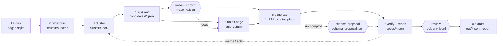

# How ditto works

ditto turns a downloaded website (an HTML directory or WARC files, up to ~100k pages) into JSON.
Instead of sending every page to an LLM, it groups pages by template, shows the LLM one
compressed *union page* per template, and asks it once for a reusable spec: XPath 1.0 selectors
plus a closed set of transforms. The spec is then verified against every page and run over the
whole site with no LLM at all.

The LLM is used only by spec generation (stage 6, one call per template plus at most one retry
when the answer does not validate), repair calls in verification and review, the opt-in
`--probe-llm` call and the opt-in `--tail direct` mode. Every other stage runs without a model.
Every stage reads and writes files in one run directory, so any stage can be rerun alone.

## 1. Ingest

`ditto ingest` reads a directory of HTML files (with an optional `urls.tsv` of `path<TAB>url`)
or WARC/WARC.gz files (or directories of them). It skips non-HTML, non-200, revisit and empty
records first, so a newer error capture never hides an older good one, then keeps the latest
capture per URL and drops byte-identical duplicates by SHA-256 (the copy with the smallest URL
survives). The encoding comes from the BOM, then the HTTP charset, then `<meta charset>` or the
XML declaration, then a strict UTF-8 check, then a statistical detector, with cp1252 as the last
resort. Pages are indexed in `pages.sqlite` with dense ids in URL order; raw bytes stay in the
original WARC (by offset) or in content-addressed blobs.

## 2. Fingerprint

Each page is parsed with lxml and cleaned: `<script>` (including JSON-LD), `<style>`,
`<noscript>`, `<svg>`, `<iframe>`, `<template>`, comments, processing instructions, and `<head>`
except `<title>` are removed. Every later stage cleans pages the same way, so this cleaned tree
is exactly what the LLM and the extractor see.

Every element gets a *structural path*: its tags from the root with canonical classes, no
positional indices, e.g. `html > body.page > div.product > dl.specs > dd`. Canonical classes
drop utility prefixes (`mt-`, `px-`, `flex`, `text-`, …), state classes (`active`, `odd`, …) and
hashed names (`css-1x2y3z`, `sc-…`, `_a1b2c`), and keep at most three, sorted. An `id` or
`data-testid` is kept only when it has no digit and does not look hashed; `itemprop` and `role`
values are kept. A page's signature is the set of its paths (repeated siblings collapse to one
entry), hashed to 64-bit integers.

## 3. Cluster into templates

Pages with identical signatures form signature groups. Paths present on more than 90% of pages
(site chrome) are dropped from the comparison. Each group gets a 128-permutation MinHash, and an
LSH index at Jaccard 0.6 proposes candidate pairs. Exact Jaccard decides: pairs at 0.75 or above
are joined; pairs between 0.6 and 0.75 are joined only when both sides share the same dominant
URL pattern (digit runs, hex ids, slugs and query values replaced by placeholders) and that
pattern covers at most 90% of the site. Union-find turns the joined pairs into clusters. Groups
made mostly of chrome are compared on their full signatures instead. Clusters smaller than
`--min-cluster-size` (default 20) are the long tail.

## 4. Analyze each cluster

On up to 2,000 sampled pages per cluster (stratified by signature group), every path gets a
presence rate `p`, a modal share `m` (the share of pages carrying the path whose text equals the
most common text) and a per-page repeat-count range. Rules, in order: `p < 0.02` on fewer than 20
sampled pages is noise; `m ≥ 0.98` is boilerplate (invariant text; such texts later serve as
labels); a repeat count that varies across pages is a list or record candidate; `p ≥ 0.95` is a
mandatory field; everything else is an optional field. Modal share, not a distinct-value ratio,
keeps low-cardinality fields such as availability. Each candidate gets a label hint (the nearest
invariant text), up to three example values and a guessed value type (email, URL, number, date,
price, text).

Tables are recognized on top: two-column structures (`<dl>`, two-column `<table>`, div pairs)
whose key cells mostly recur across pages become `key_value` tables; header rows over varying
rows become `record_list` tables with column names from the header text; headerless tables
become `record_list` tables with columns `col1`, `col2`, …; repeated sibling blocks (`ul > li`,
`div.card`) with two or more varying parts become `record_list` tables whose columns are named
from their paths.

## 5. Union page

One page per template is built for the LLM. The base is the page, among up to 100 sampled ones,
that covers the most candidates (smaller page, then lower id, on ties). Every field candidate the
base lacks is spliced in from a donor page after the nearest shared preceding sibling, most
frequent first, while the estimated tokens of the spliced units stay within the page's token cap
(`ditto analyze --max-tokens`, 30,000 by default); candidates left over when that splice budget is
spent are listed as `budget_skipped` in `union/<template>.json`. A splice whose candidate does not
then locate on the page, or that hides an at least as frequent candidate, is undone. A candidate
none of those 100 pages carries is looked for in the rest of the analysis sample (up to 2,000
pages, read until every missing candidate is found, and only while splice budget is left;
`union/<template>.json` records `searched_pages`). A missing labeled row or section is spliced as
a row of its own, never inside another field's row with the same path, and a label and value that
share one path are spliced together with their parent. Rare value cells of a detected table
(record columns or key-value values the analysis classed as noise) are shown and annotated too.

Candidates are annotated with HTML comments only (`<!-- c17 · optional · on 41% of pages ·
e.g. … -->`, `c18 @href · …` for attributes, `c43 · noise · …` for rare table cells), so nothing
the LLM sees is selectable that real pages lack. Long text is cut (120 characters, 300 inside
candidates, 80 for links), attributes are pruned and candidate-free boilerplate subtrees (nav,
footer, cookie banners and the like) are removed. Repeated siblings are collapsed by variant
(never key-value lists or siblings with distinct labels, where each repetition is a different
field). The page must fit the token cap (tiktoken `o200k_base`); when it does not, subtrees
without candidates are dropped, then the collapse is made more aggressive in steps (dropping
candidate-free subtrees again at each step), then candidate text is cut to 120 characters, and
finally the rarest candidates are dropped. Small pages are never padded.

## 6. Generate a spec (one LLM call)

The LLM receives the union page, the compact candidate table (id, class, `p`, repeat range, label
hint, value type, table role, examples), the detected tables, the spec JSON Schema and the mode
instructions (prompt `prompts/specgen.v2.md`; the loader always picks the highest version and
records it in the spec's `generated_by`). In *prompted* mode it maps the user's `fields.yaml` to
candidates (a field it cannot find comes back in `not_present` with a reason). In *unprompted*
mode it filters the candidates to entity data, names fields in `snake_case` and types them.
Scalar and list fields get two or three candidate selectors; record lists get a container
selector with alternates and one XPath per column; key-value fields a pairs selector with
alternates. The answer is validated against the Pydantic spec model and every XPath is compiled
and linted (XPath 1.0 core functions only, no `comment()` or `data-x-` reference, no unanchored
positional paths); one retry carries the exact errors back. If the retry fails too, the fields
that validate on their own are kept and the rest fall back to path-induced selectors in
verification. Before the first call, the projected cost of all templates is checked against the
remaining budget; a budget that runs out mid-run leaves the remaining templates `unprocessed`.

With a `mapping.json` (prompted mode), each mapped field records who chose it (provenance `user`
or `auto`). Choices a person made (an answer in the terminal walk-through, a `use` changed in
`probe.yaml` or marked `confirmed: true`, an `edits` entry of `Probe.confirm`) are binding: the
prompt states them and fields marked `absent` are not asked for. The probe's proposal accepted
unseen (`confirm --yes`) is passed as ranked suggestions (top three) the model may overrule, and a
field the probe could not find is still asked for. The union page is rebuilt trimmed to the
neighborhoods (plus labels) of the confirmed candidates and of every suggestion, overwriting
`union/<template>.html` with the page the model saw; when some requested field has nothing to
focus on, the full union page is used. Templates the mapping excludes or does not list are
skipped. A `mapping.json` written before provenance existed loads as confirmed by a person.

## 7. Verify and repair

Every candidate selector runs on every page of the cluster. Each is scored on presence against
the analysis' expected rate, multiplicity (a scalar must match exactly one node; a list must not
return more nodes than the analysis path has; for record and key-value fields, the row count
against the real sibling count on a sample) and type checks (email, URL, number, date, price).
The winner maximizes `presence × multiplicity × type_pass`; scores within 0.02 of each other (with
the same multiplicity and type pass) count as tied, and ties go to fewer positional steps, then to
more agreement with the other candidates. Candidates that agree with the winner on at least 98%
of the pages where both match are kept as fallbacks.

A field fails on a page when the analysis says it exists there but the winner finds nothing,
matches several nodes for a scalar, or fails its type check. Fields failing on more than 1% of
the pages where they are expected are repaired: failing pages are grouped by signature group, the
group with the most failing pages first, and each repair call (prompt `repair.v1`) covers every
field failing in that group and shows the group's page where most of them fail (at most 3 calls
per template by default, `--max-repair-calls`). A repair is kept only if it fails on fewer pages
and leaves the values on at least 98% of the already passing pages unchanged; fields still
failing on more than 1% of pages are marked `degraded`. When the budget runs out, repairs stop for
the rest of the run. When every LLM candidate scores near zero (below 0.05), or generation
produced no valid selector, a path-induced selector is built from the candidate's own structural
path, with no LLM. Fields with an expected presence below 0.95 are marked optional.

Clusters are then split and merged. A signature group is split off when a field is present on
fewer than half of its pages but on more than 95% elsewhere (each side needs at least three
pages); the new cluster starts from a copy of the parent's spec and is verified on its own pages.
Near-duplicate templates merge when one spec works on both: the larger cluster A absorbs B when
A's spec, which needs an anchor field present on at least 90% of A's pages, reaches its own
presence rates within sampling tolerance (two binomial standard errors, at least 0.05) on up to
20 sampled pages of B, and, when B has a spec of its own, B's spec does the same on A's pages.
B's fields that A lacks are carried over into A's spec.

## 8. Extract

Final specs run over every page with no LLM, writing one JSONL file per template:
`{url, page_id, template_id, <fields>, _meta: {missing, spec_version}}`, plus `report.json` and
`report.md` with cluster sizes and URL examples, per-field statistics, token and cost totals and
stage timings. The runner's `normalize-space()` treats no-break spaces (U+00A0) as spaces, as the
text the LLM read does, so a label predicate such as `normalize-space()='Price:'` matches
`Price:&nbsp;`; a plain lxml consumer of a spec gets standard XPath 1.0 behavior instead.

## Checkpoints

`ditto probe` maps requested fields to candidates of every non-tail template without an LLM
(label-hint similarity to the field name and description, a small synonym list, value types,
agreement with user examples, and the rule that a label is never a field) and marks each field
found, ambiguous or missing per template; a template holding no requested field is proposed as
excluded. `--probe-llm` resolves ambiguous fields with one small-model call per template over the
candidate table (prompt `probe.v1`). `ditto confirm` accepts `probe.yaml` as it stands (`--yes`)
or lets you edit it in `$EDITOR` or a terminal walk-through, and writes `mapping.json`.

After verification, `ditto review` shows five records per template beside their source text for
sign-off and saves them as golden samples; fields you reject are recorded in `review.json` and
sent, with your note, to one repair call per template, whose selector replaces the rejected one
when it matches anything. In unprompted mode the first checkpoint is the schema proposal shown
after generation instead of probe and confirm: you can drop or rename fields, and the changes are
applied to the draft specs before verification.

`ditto run` asks at both checkpoints in a terminal. With `--yes` it accepts both; without a
terminal and without `--yes` it stops before ingesting and asks for `--yes`.

## Long tail

Pages in clusters below `--min-cluster-size` are skipped by default. `--tail direct` (prompted
mode, `ditto run` or `ditto extract`) sends each of them, cut to about 12k tokens, to the small
model with the prompted schema (prompt `tail_direct.v1`) and writes `out/<site>/_tail.jsonl` with
`template_id: null`; `--tail spec` analyzes the tail clusters and generates specs for them anyway.

## LLM calls

Prompts are versioned files (`prompts/<name>.v<N>.md`; a changed prompt is a new file). The JSON
Schema of the expected answer is written into the prompt rather than delegated to the provider's
structured output; the answer is parsed (code fences stripped), validated, and retried once with
the errors. Responses are cached under `<DITTO_CACHE_DIR>/llm/`, keyed by SHA-256 of the prompt
version, `provider/model` and the full request; cached calls cost nothing and keep their token
counts. 429, 5xx and connection errors are retried with exponential backoff and jitter. Before
each real call its worst-case cost is reserved against `LLM_BUDGET_USD` minus the spend ledger
(and the optional `DITTO_RUN_BUDGET_USD`), so concurrent calls cannot overspend. Every call is
recorded in the run's `usage.jsonl`; real spend goes to the ledger, billed at the service tier the
provider reports (Flex at half price per `config/prices.yaml`), while `list_cost_usd` stays at
standard prices for cost tables.
